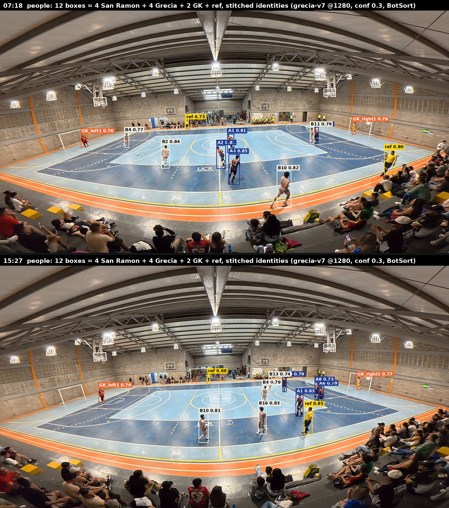
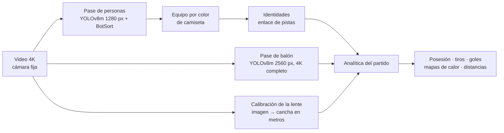
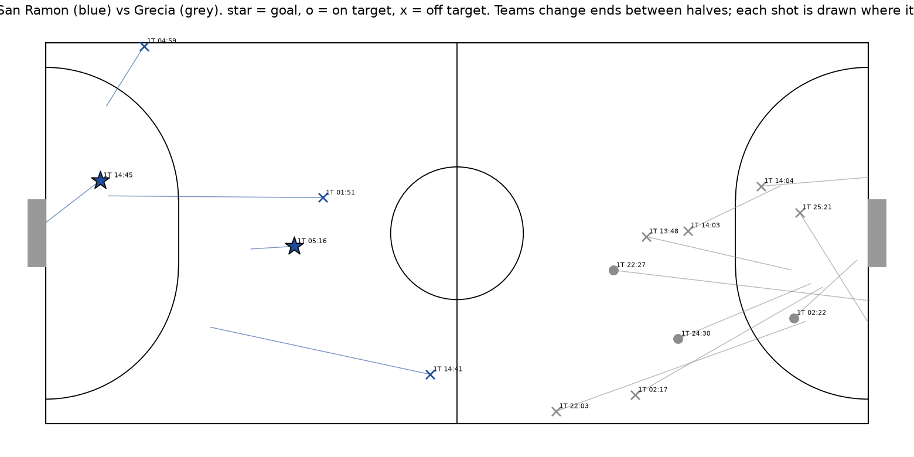
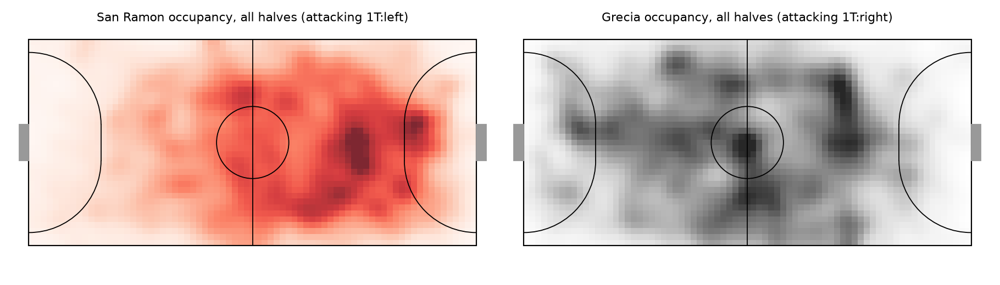

# Futsal UCR: análisis de partidos con visión por computadora

Sistema desarrollado en la Universidad de Costa Rica para analizar partidos de futsal a partir de **una sola cámara fija 4K**. Detecta balón, jugadores, porteros y árbitros con YOLOv8, los sigue en el tiempo, los proyecta a la cancha en metros y produce estadísticas del partido: posesión, tiros, goles, mapas de calor y distancia recorrida.

Los resultados provisionales del primer tiempo analizado (mapa de tiros, mapas de calor y distancias) se pueden ver en **[tomas0821.github.io/Futsal-UCR-Vision-computacional](https://tomas0821.github.io/Futsal-UCR-Vision-computacional/)**.

El repositorio presenta los métodos y los resultados del proyecto: cada carpeta `ejemplo-N` es un experimento de entrenamiento o inferencia reproducible en el clúster de la UCR, y `analisis-partido/` contiene el procesamiento posterior que convierte las detecciones en estadísticas.



*Primer tiempo San Ramón vs Grecia (9 de mayo de 2026), minutos 07:18 y 15:27: 4 + 4 jugadores de campo, dos porteros y el árbitro, cada uno con su identidad y equipo.*

## Cómo funciona



1. **Detección.** Un solo modelo YOLOv8m (`grecia-v7`) con cuatro clases: `bola`, `juga`, `port`, `ref`. Las personas se detectan sobre el video a 1080p; el balón, de unos 15 px en 4K, necesita un pase aparte sobre el video 4K completo a 2560 px.
2. **Seguimiento.** BotSort ajustado para cámara fija (memoria de 3 s, sin compensación de movimiento). Cada pista recibe un equipo por el color de la camiseta y las pistas se enlazan en identidades por equipo.
3. **Calibración.** Un modelo de lente ojo de pez ajustado con unos 15 puntos de la cancha marcados a mano en un cuadro; convierte píxeles en metros con un error de medio metro aproximadamente.
4. **Analítica.** Posesión por cercanía al balón, tiros por velocidad y dirección del balón, goles por la formación de saque de centro que sigue a cada gol, mapas de calor y distancia por identidad.

La descripción completa de cada etapa, con los comandos y los formatos de datos, está en [docs/pipeline.md](docs/pipeline.md).

## Modelos entrenados

| Modelo | Tarea | Dataset (Roboflow `football-ucr`) | mAP50 | mAP50-95 | Carpeta |
| :--- | :--- | :--- | ---: | ---: | :--- |
| **grecia-v7** YOLOv8m, 1280 px | balón + jugadores + porteros + árbitros | `grecia` v7: 2 274 imágenes de 4 partidos | **83.3** | **46.8** | [ejemplo-5-grecia](ejemplo-5-grecia/) |
| ejemplo-2 YOLOv8m | porteros, jugadores, árbitros | `futsal-ucr` v8 | 96.3 | 62.9 | [ejemplo-2](ejemplo-2-jugadores-y-arbitros/) |
| ejemplo-1 YOLOv8m | balón | `ucr-futsal-ball2` v6 | 93.0 | 60.9 | [ejemplo-1](ejemplo-1-deteccion-basica/) |
| ejemplo-4 YOLOv8m-pose | 10 puntos clave de la cancha | `ucr-futsal-field3` v3 | 99.5 | 98.2 | [ejemplo-4](ejemplo-4-deteccion-cancha-keypoints/) |

Los mAP de distintos datasets no se comparan entre sí: los modelos de los ejemplos 1 y 2 se midieron en sus propios datos, con cámaras más cercanas. Sobre el video 4K de la cámara fija, el detector de balón del ejemplo 1 encuentra el balón en el 18 % de los cuadros; `grecia-v7` a 2560 px, en el 62 % del primer tiempo completo y el 71 % del clip de prueba. Las tablas completas, incluida la comparación sobre el video real, están en [docs/resultados.md](docs/resultados.md).

Los pesos (`.pt`) no viven en el repositorio: se descargan desde la página de [Releases](https://github.com/tomas0821/Futsal-UCR-Vision-computacional/releases) o desde el [espejo institucional en git.ucr.ac.cr](https://git.ucr.ac.cr/futsal-ucr/vision-computacional/-/releases). El video completo del primer tiempo está en [YouTube](https://youtu.be/5ASmzIn9ooI).

## Un primer tiempo analizado de principio a fin

Primer tiempo San Ramón vs Grecia, 27 minutos, 82 252 cuadros procesados sin intervención manual.

| | San Ramón | Grecia |
| :--- | ---: | ---: |
| Goles detectados (resultado real 3 – 1) | 3 | 0 |
| Posesión | 26 % | 74 % |
| Tiros / a puerta | 5 / 1 | 9 / 3 |

<p>


</p>

El gol de Grecia (minuto 10:42) no se detectó porque San Ramón reinició el juego en diez segundos, sin la formación de saque de centro que el detector busca. Las distancias por jugador que produce la versión actual de `match_analytics.py` están infladas alrededor de un tercio por el temblor cuadro a cuadro del rastreo; el valor corregido ronda los 95 a 100 m/min por jugador de campo. El detalle está en [docs/resultados.md](docs/resultados.md#distancias-y-velocidades).

## Estructura del repositorio

| Carpeta | Contenido |
| :--- | :--- |
| [ejemplo-1-deteccion-basica](ejemplo-1-deteccion-basica/) | Entrenamiento e inferencia de un detector de balón (YOLOv8n vs YOLOv8m). |
| [ejemplo-2-jugadores-y-arbitros](ejemplo-2-jugadores-y-arbitros/) | Detector de personas en tres clases, con filtrado del dataset. |
| [ejemplo-3-modelos-combinados](ejemplo-3-modelos-combinados/) | Inferencia simultánea con dos modelos sobre un video. |
| [ejemplo-4-deteccion-cancha-keypoints](ejemplo-4-deteccion-cancha-keypoints/) | Puntos clave de la cancha con YOLOv8-pose. |
| [ejemplo-5-grecia](ejemplo-5-grecia/) | Modelo unificado de cuatro clases, seguimiento con BotSort y pase de balón en 4K. Es el modelo en uso. |
| [analisis-partido](analisis-partido/) | Calibración de la cámara, equipos, identidades, trayectoria del balón, analítica y visualización. |
| [docs](docs/) | Pipeline, resultados, figuras, los CSV del primer tiempo analizado y el sitio web (`index.html`, servido con GitHub Pages). |
| [analisis-bibliografico](analisis-bibliografico/) | Estado del arte en visión por computadora deportiva. |

## Reproducir

```bash
git clone https://github.com/tomas0821/Futsal-UCR-Vision-computacional
cd Futsal-UCR-Vision-computacional
conda env create -f environment.yml      # o: pip install -r requirements.txt
conda activate futsal_env
cp ejemplo-1-deteccion-basica/.env.example ejemplo-1-deteccion-basica/.env   # y escribir la clave de Roboflow
```

Entorno probado: Python 3.11, Ultralytics 8.4, PyTorch con CUDA, una GPU A100 por trabajo. Cada ejemplo se ejecuta desde su carpeta: `python download_dataset.py`, `sbatch train_futsal.sh` y `sbatch predict_futsal.sh videos/clip.mp4`. Los trabajos de GPU van por SLURM. El posprocesamiento de `analisis-partido/` corre en CPU en cualquier máquina; los comandos están en [docs/pipeline.md](docs/pipeline.md).

## Datasets

| Dataset | Proyecto Roboflow | Versión en uso | Contenido |
| :--- | :--- | :--- | :--- |
| Grecia | `football-ucr/grecia` | 7 | 1 291 cuadros 4K de 4 partidos (San Ramón, Grecia, Caribe, Los Chiles), 4 clases, exportados a 1280 × 1280 con duplicado aumentado. |
| UCR-Futsal-Ball2 | `football-ucr/ucr-futsal-ball2` | 6 | Balón, cámaras cercanas. |
| Futsal-UCR | `football-ucr/futsal-ucr` | 8 | Porteros, jugadores y árbitros. |
| ucr-futsal-field3 | `football-ucr/ucr-futsal-field3` | 3 | 10 puntos clave de la cancha. |

La clave de la API se guarda en `ejemplo-1-deteccion-basica/.env`; los demás ejemplos la leen desde ahí.

## Limitaciones conocidas y trabajo futuro

- **El balón es el cuello de botella.** Mide unos 7 px en la imagen que ve el modelo; el mAP50 del balón se queda en 60 con cualquier volumen de datos. Pendiente: exportar el dataset a 1920 × 1080 sin estirar, anotar más balones en el aire y lejanos.
- **Las identidades aún no son dorsales.** Las pistas se enlazan por equipo y continuidad, y duran de 1 a 11 minutos. La lectura de números de camiseta está en `analisis-partido/experimental/`.
- **Goles con reinicio rápido.** El detector depende de la formación de saque de centro; un reinicio inmediato se pierde.
- **Distancias.** Hay que suavizar la trayectoria antes de integrar la distancia y calcular la velocidad máxima con ventana de 1 s.
- **Segundo tiempo y partido completo.** El procesamiento del video (voltear, recodificar, 4K) conviene hacerlo en el clúster; una máquina de escritorio con poca memoria no basta.

## Autoría

Proyecto de investigación [C6316](https://vinv.ucr.ac.cr/sigpro/web/projects/C6316) de la Universidad de Costa Rica, Sede Regional de Occidente, inscrito en la Vicerrectoría de Investigación: «Implementación de un protocolo para el análisis del rendimiento deportivo mediante videos, utilizando algoritmos de inteligencia artificial: una aplicación en fútbol sala» (2026–2027). Coordinador: Jorge Salazar. Equipo: Tomás Rojas y Eduardo Arias, con la participación de estudiantes asistentes. Entrenamiento e inferencia en el clúster HPC de la UCR (GPU A100, SLURM). Para citar el repositorio, ver [CITATION.cff](CITATION.cff).
