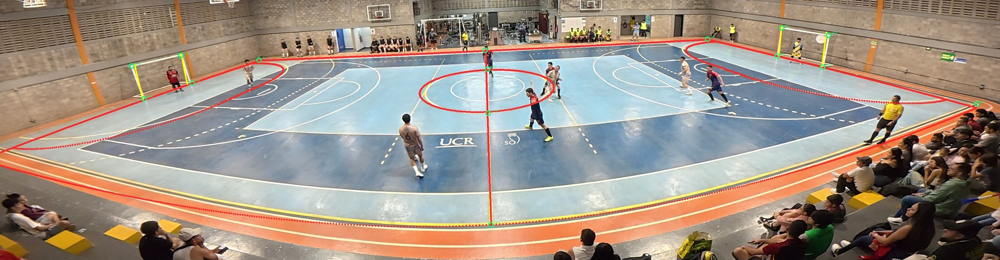

# Análisis de partido: calibración, equipos, identidades, balón y estadísticas

Scripts de posprocesamiento que convierten las detecciones del clúster (`track_details.txt` y `ball_candidates.txt`, ver [ejemplo-5-grecia](../ejemplo-5-grecia/)) en trayectorias sobre la cancha en metros y en estadísticas del partido. Corren en CPU, en cualquier máquina con Python 3.11, NumPy, SciPy, Matplotlib, Pillow y ffmpeg. Todos se ejecutan desde la raíz del repositorio y aceptan `--help` implícito en su docstring (primeras líneas de cada archivo).

El orden de las etapas y los formatos de datos están en [docs/pipeline.md](../docs/pipeline.md).

## Calibración de la cámara (una vez por posición de cámara, unos 3 minutos)

1. **Elegir un cuadro limpio** del partido, 4K y enderezado, con las dos porterías visibles.
2. **Abrir `click_landmarks.html` en un navegador** (doble clic, no necesita servidor). Cargar el cuadro, escribir el nombre del partido, comprobar largo y ancho (por defecto 37.19 × 17.2 m).
3. **Marcar los puntos en el orden indicado** (rueda = zoom, clic derecho o Espacio + arrastrar = desplazar; la lupa muestra el píxel exacto). Tecla **S** salta lo que no se ve. Mínimo: ambas porterías (4 bases de poste + 4 extremos de travesaño), los extremos de la línea central y las esquinas visibles.
4. **Descargar el JSON** como `<partido>_landmarks.json` y guardarlo en `calibraciones/`.
5. **Ajustar:**
   ```bash
   python analisis-partido/fit_from_clicks.py analisis-partido/calibraciones/<partido>_landmarks.json cuadro.jpg --out analisis-partido/calibraciones/<partido>_camera.npz
   ```
   Imprime el error por punto en píxeles y metros. Más de 40 px es un clic equivocado: recargar el JSON en el navegador, corregir, descargar y reajustar. Escribe `<partido>_camera.npz` (lo usan los demás scripts), `<partido>_camera.json` (resumen legible) y una imagen con el contorno de la cancha sobre el cuadro, que hay que revisar.
6. **Comprobar que la cámara no se movió** entre partes de la grabación: `python analisis-partido/overlay_check.py calib.npz salida.jpg cuadro1.jpg cuadro2.jpg`.

Marco de la cancha: X a lo largo de la banda lejana desde la línea de meta izquierda, Y desde la banda lejana hacia la cámara, Z hacia arriba, en metros. Modelo: ojo de pez equidistante con polinomio de dos términos en θ; se ajustan pose, focal y punto principal, así que otra posición de trípode o zoom solo necesita nuevos clics. La calibración de Grecia (9 de mayo de 2026) está en `calibraciones/` y es la que `pitch_map.py` usa por defecto.



## Posprocesamiento de un tiempo

```bash
bash analisis-partido/posproceso_tiempo.sh RUN_DIR video_1080p.mp4 PREFIJO RUN_DIR/ball_candidates.csv analisis-partido/calibraciones/grecia_2026-05-09_camera.npz
```

Necesita `RUN_DIR/track_details.txt` (si la grabación vino en partes, unirlas antes con `merge_track_parts.py`). Encadena `pitch_map.py` → `team_colors.py` → unión de equipos y coordenadas → `stitch_tracks.py` → `ball_track.py`, e imprime qué mitad defiende cada equipo en los dos primeros minutos.

## Estadísticas y figuras

```bash
python analisis-partido/match_analytics.py salida/partido --names "A=San Ramon;B=Grecia" \
  --half 1T RUN_DIR/PREFIJO_stitched.csv RUN_DIR/ball_track_c0.2.csv A=left,B=right
```

## Índice de scripts

| Script | Función |
| :--- | :--- |
| `pitch_map.py` | Píxeles → cancha en metros con la calibración (`--scale 2` para pistas de 1080p). |
| `fit_from_clicks.py`, `click_landmarks.html`, `overlay_check.py` | Calibración de la lente y comprobación. |
| `merge_track_parts.py` | Une los `track_details.txt` de varias partes con desplazamiento de cuadros. |
| `team_colors.py` | Equipo por color de camiseta (torso, Lab); parte pistas donde cambia el equipo. |
| `stitch_tracks.py` | Enlaza segmentos por equipo en identidades (asignación global). |
| `ball_track.py` | Trayectoria del balón a partir de los candidatos, con filtrado en la cancha e interpolación ≤ 0.5 s. |
| `match_analytics.py` | Posesión, tiros, goles, distancias, mapas de calor; uno o más tiempos. |
| `render_tracks.py`, `render_ball.py` | Videos anotados (personas; balón con cajas opcionales, rótulo y reloj). |
| `ball_plots.py`, `ball_montage.py` | Figuras del balón y muestrario de recortes para verificar precisión. |
| `chain_gantt.py`, `player_stats.py`, `team_plots.py`, `timeline_plots.py`, `plot_pitch_tracks.py` | Figuras de identidades, segmentos, equipos y líneas de tiempo. |
| `radar_video.py` | Vista cenital animada. |
| `example_frames.py` | Cuadros de ejemplo de detección completa y casos difíciles. |
| `track_diagnostics.py`, `compare_runs.py` | Calidad del seguimiento; comparación de dos corridas. |
| `export_review.py`, `review_identities.html`, `apply_corrections.py` | Revisión y corrección manual de identidades. |
| `posproceso_tiempo.sh` | Encadena el posprocesamiento de un tiempo. |

## Revisión manual de identidades

1. `python analisis-partido/export_review.py RUN_DIR/PREFIJO_stitched.csv RUN_DIR/review.json --step 2`
2. Abrir `review_identities.html` en el navegador, cargar el clip 1080p y el JSON. Las cajas aparecen con su identidad (A…, B…, GK…).
3. Clic en una caja, elegir la identidad correcta y: **R** reetiquetar el segmento, **X** desde este cuadro en adelante, **W** intercambiar dos identidades desde aquí, **D** borrar el segmento, **N** nueva identidad, **P** marcar a mano los pies de un jugador perdido cada pocos segundos, **Z** deshacer.
4. Descargar `identity_corrections.json` y aplicarlo con `apply_corrections.py`; luego regenerar video y figuras.

## `experimental/`: lectura de dorsales

`number_crops.py` recorta torsos del video 4K por identidad; `number_ocr.py` los lee con EasyOCR y vota por identidad; `train_digits.py` y `apply_digits.py` entrenan y aplican un clasificador ResNet-18 de dígitos sobre los recortes; `number_assign.py` asigna un dorsal por segmento con una regla de unicidad por cuadro. Funciona en los jugadores cercanos a la cámara y falla en los lejanos; no forma parte del pipeline todavía.
