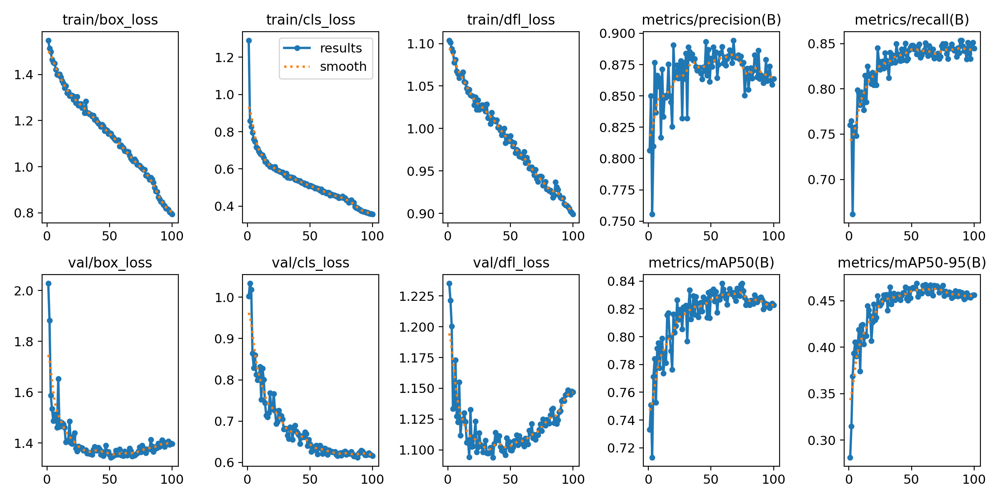
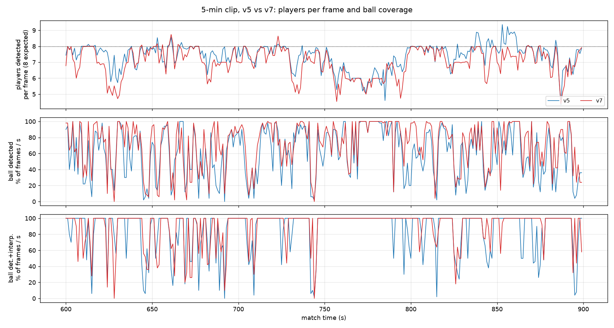
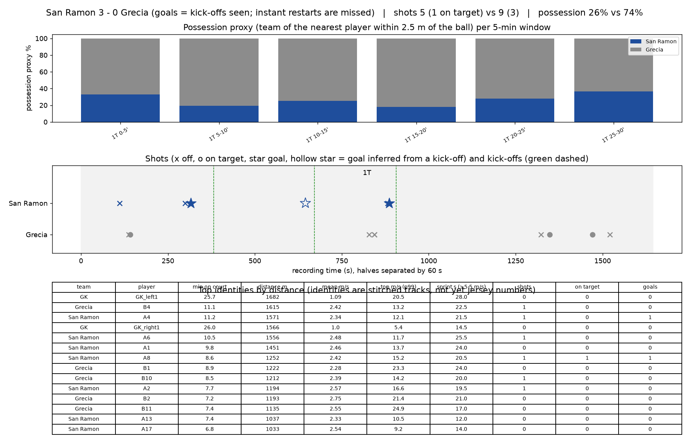
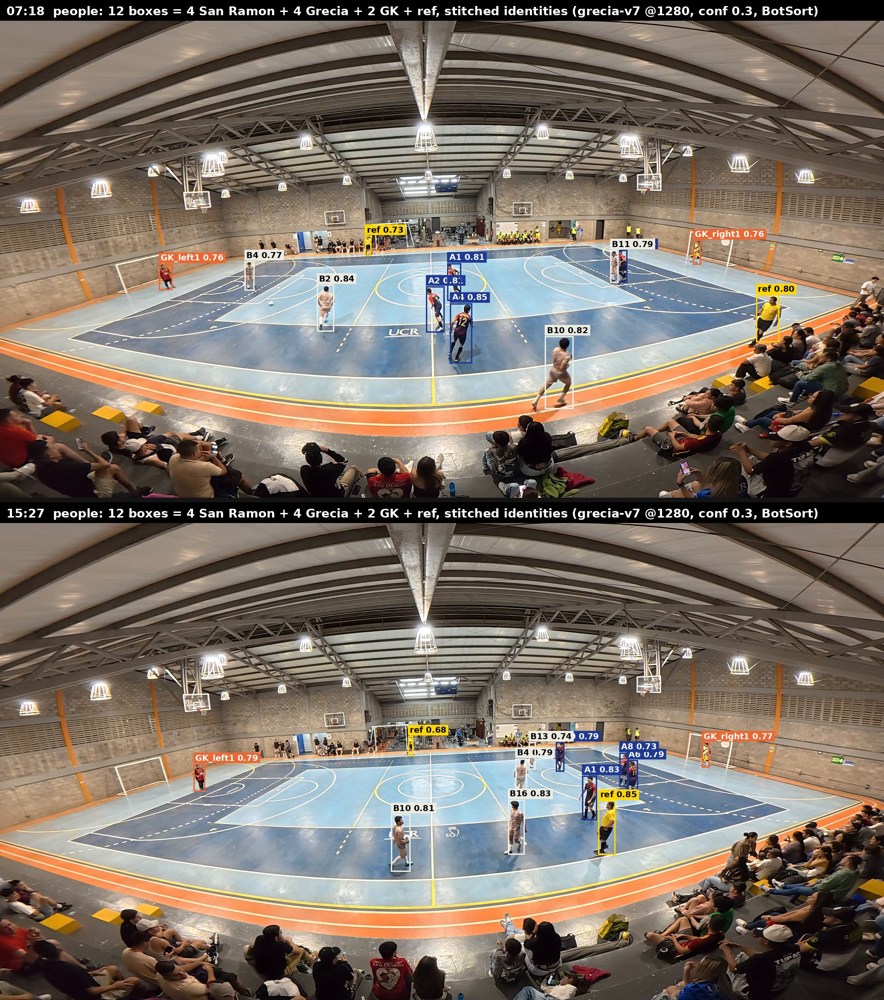
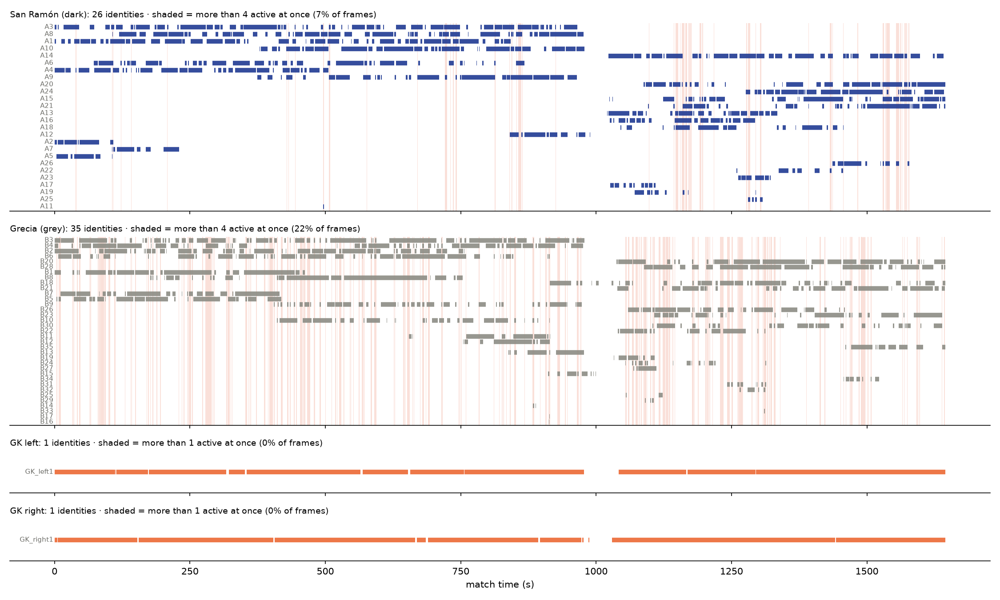
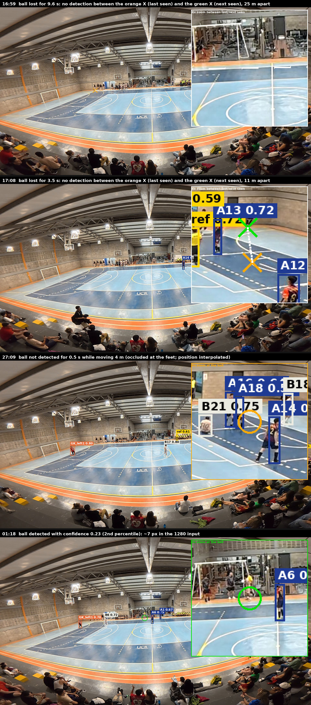
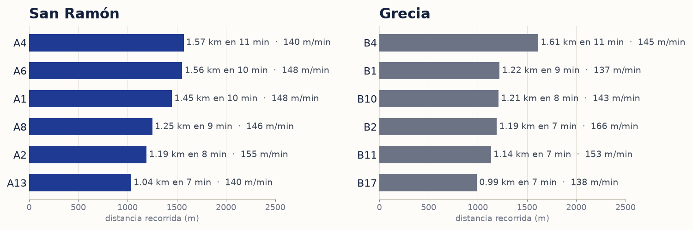

# Resultados

Todos los mAP son de validación, en porcentaje. Solo son comparables dentro de un mismo bloque: cada dataset tiene cámaras, distancias y dificultad distintas.

## Línea `grecia` (cuatro clases, YOLOv8m)

| Modelo | Entrenamiento | Validación | mAP50 | mAP50-95 | bola | juga | port | ref |
| :--- | :--- | :--- | ---: | ---: | ---: | ---: | ---: | ---: |
| grecia-v4 | 560 cuadros del 1T de Grecia, 512 px | partición | 69.7 | 40.0 | 17.0 | 87.2 | 91.0 | 83.6 |
| grecia-v5 | mismos cuadros, 1280 px estirado, 2× aumento | partición | 81.9 | 45.2 | 60.3 | 89.8 | 89.7 | 88.0 |
| **grecia-v7** | 1 291 cuadros de 4 partidos, 1280 px, 2× aumento | partición (207) | **83.3** | **46.8** | 60.2 | 91.7 | 90.2 | 91.0 |
| grecia-v7 sin Los Chiles | v7 menos un partido | Los Chiles (391) | 78.1 | 44.2 | 56.7 | 85.5 | 75.8 | 94.4 |

Lectura: de v4 a v5 la ganancia es resolución (el balón pasa de 17 a 60 de mAP50); de v5 a v7 es amplitud de datos, sobre todo en personas y en generalización a un partido no visto. El balón se queda en 60 de mAP50 sea cual sea el volumen de datos: mide unos 7 px en la imagen de 1280 × 1280 que ve el modelo.

## Modelos anteriores de una sola tarea

| Modelo | Dataset | mAP50 | mAP50-95 |
| :--- | :--- | ---: | ---: |
| Balón, ejemplo 1, YOLOv8n / **YOLOv8m** | UCR-Futsal-Ball2 v6 | 89.1 / **93.0** | 51.8 / **60.9** |
| Balón, ucr-futsal-ball2 v1 / v3 / v4 / v4-8x / v5-8x / **v6-8x** | ball2 v1 a v6 | 93.7 / 78.9 / 86.4 / 89.7 / 90.4 / **93.9** | 68.7 / 50.2 / 48.7 / 62.5 / 61.6 / **70.5** |
| Balón, futsal-specialized v2 / v3 / **v4** | local | 42.1 / 39.9 / **96.6** | 22.3 / 18.4 / **74.9** |
| Personas, ejemplo 2, YOLOv8m (gk / player / ref) | Futsal-UCR v8 | **96.3** (98.4 / 95.5 / 95.8) | 62.9 |
| Personas, futsal-ucr v4 / v5 / v7 / v8 | Futsal-UCR | 74.7 / 72.5 / 62.2 / 71.5 | 39.9 / 45.5 / 31.2 / 38.3 |
| Cancha, ejemplo 4, YOLOv8m-pose, 10 puntos | ucr-futsal-field3 v3 | 99.5 | 98.2 |

## Sobre el video real (lo que importa)

Clip de 5 minutos del primer tiempo (15 000 cuadros) y primer tiempo completo (82 252 cuadros), misma cámara fija 4K.

| Medida | v5 | v7 (conf 0.4) | v7 (conf 0.3) |
| :--- | ---: | ---: | ---: |
| Clip: balón detectado / con interpolación | 61 % / 85 % | **71 % / 89 %** | – |
| Clip: tracklets de balón | 70 | **49** | – |
| Clip: pistas de personas / vida mediana | 201 / 5.3 s | **152 / 10.0 s** | 242 / 5.5 s |
| Clip: cambios de identidad | 129 | **84** | 143 |
| Clip: jugadores por cuadro (esperados 8) / exactamente 8 / menos de 7 | 7.39 / 50 % / 17 % | 7.02 / 37 % / 28 % | **7.36 / 51 % / 18 %** |
| 1T completo: balón detectado / con interpolación | 54 % / 78 % | **62 % / 85 %** | (mismo pase) |
| 1T completo: pistas → identidades San Ramón / Grecia | 980 → 26 / 35 | – | 1 112 → 18 / 27 |
| ball2-v6 (YOLOv8x, 93.9 en su propio dataset) sobre el 4K, en mosaicos | 18 % / 39 % | | |

Decisión vigente: v7 para el pase de balón y, para las personas, v7 a confianza 0.3 (misma cobertura de jugadores que v5 y menos pistas rotas) o v5 a 0.4.

## Primer tiempo San Ramón vs Grecia (9 de mayo de 2026)

Procesado con grecia-v7, 82 252 cuadros, sin intervención manual. Los CSV completos están en [datos_1T/](datos_1T/).

| | San Ramón (A, camiseta oscura, ataca a la izquierda) | Grecia (B, camiseta gris, ataca a la derecha) |
| :--- | ---: | ---: |
| Goles detectados | 3 | 0 |
| Resultado real | 3 | 1 |
| Posesión | 26 % | 74 % |
| Tiros / a puerta | 5 / 1 | 9 / 3 |
| Distancia media de tiro | 11.1 m | 9.2 m |

Validación del detector de goles cuadro a cuadro:

| Minuto | Detector | Evidencia | Video |
| :--- | :--- | :--- | :--- |
| 05:16 | Gol San Ramón | tiro que cruzó la línea; saque de Grecia en 06:20 | confirmado |
| 10:42 | nada | Grecia marca y San Ramón reinicia en 10 s, sin formación | **gol perdido** |
| 10:45 | Gol San Ramón (inferido) | solo formación de saque; saque en 11:10 | confirmado |
| 14:45 | Gol San Ramón | tiro a puerta; saque en 15:05 | confirmado |
| 22:27, 24:30, 25:21 | posible gol | balón cruzó la línea, sin saque posterior | paradas del portero sobre la línea |

### Detección de personas

El 36 % de los cuadros del primer tiempo tiene exactamente 4 + 4 jugadores de campo con equipo asignado; el resto suele tener uno de menos (tapados entre sí) o uno de más (camiseta gris mal clasificada).

### Casos difíciles del balón

De izquierda a derecha y de arriba abajo: balón perdido 9.6 s y 25 m (16:59); perdido 3.5 s y 11 m (17:08); medio segundo tapado entre las piernas, posición interpolada (27:09); detectado en el fondo con confianza 0.23 y unos 7 px (01:18).

### Distancias y velocidades

Las etiquetas (A4, B2, …) son identidades del enlazador de pistas, no dorsales; duran entre 1 y 11 minutos. **Los valores de la figura están inflados.** `match_analytics.py` suma la distancia cuadro a cuadro a 50 fps sin suavizar, y el temblor de la caja se acumula como recorrido. Recalculando desde las mismas trayectorias:

| Identidad | Crudo | Suavizado 0.5 s | Remuestreo 1 Hz |
| :--- | ---: | ---: | ---: |
| A4, 11.2 min | 1 571 m, 140 m/min | 1 087 m, 97 m/min | 813 m, 73 m/min |
| B4, 11.1 min | 1 615 m, 145 m/min | 1 074 m, 97 m/min | 685 m, 62 m/min |
| San Ramón, jugadores de campo | 13.4 km | 9.2 km | 6.6 km |
| Grecia, jugadores de campo | 15.9 km | 10.4 km | 6.6 km |

El valor realista está cerca de la columna suavizada: 95 a 100 m/min por jugador de campo, frente a 117 a 121 m/min del futsal de élite medido con sistemas de posicionamiento. Los porteros pasan de 66 a 34 m/min al suavizar, lo que da la magnitud del ruido de fondo. La columna `top_speed` del CSV (percentil 99 de la velocidad suavizada a 0.5 s) produce valores imposibles de 20 a 43 m/s en identidades cortas: el filtro reparte en medio segundo el salto de una unión entre pistas. Con ventana de 1 s dentro de cada tramo continuo, la velocidad máxima por identidad queda entre 4 y 7.3 m/s (hasta 26 km/h), que sí es realista. `sprint_s` sufre el mismo artefacto. Corrección pendiente: suavizar antes de integrar y medir la velocidad máxima con ventana de 1 s.
