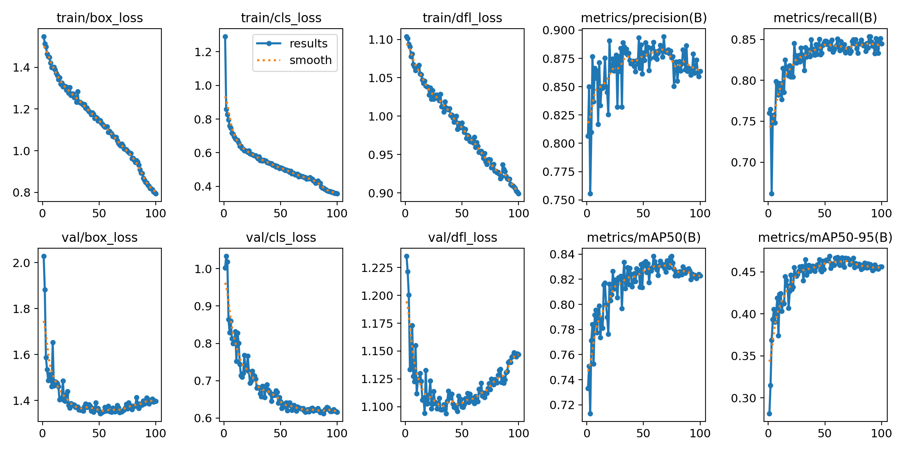

# Ejemplo 5: modelo unificado de cuatro clases, seguimiento y pase de balón

Un solo modelo **YOLOv8m** detecta balón, jugadores, porteros y árbitros en el video de la cámara fija 4K. Es el modelo que usa el pipeline completo del proyecto (ver [docs/pipeline.md](../docs/pipeline.md)).

| Clase | ID | Descripción |
| :--- | :-: | :--- |
| `bola` | 0 | Balón |
| `juga` | 1 | Jugador de campo |
| `port` | 2 | Portero |
| `ref` | 3 | Árbitro |

## Dataset

Proyecto Roboflow `football-ucr/grecia`. Los cuadros son 4K de la cámara Osmo, exportados a 1280 × 1280 (estirado) con un duplicado aumentado por imagen.

| Versión | Cuadros fuente | Partidos | Imágenes exportadas | Notas |
| :--- | ---: | :--- | ---: | :--- |
| v4 | 560 | Grecia 1T | 560 a 512 px | el balón mide 2 a 4 px: inservible para `bola` |
| v5 | 560 | Grecia 1T | 1 120 a 1280 px | mismo material, resolución útil |
| **v7** | 1 291 | Grecia, San Ramón, Caribe, Los Chiles | 2 274 a 1280 px | 207 de validación; Roboflow exporta seis clases y `prepare_v7.py` funde `gk → port` y `player → juga` |

`download_dataset.py` descarga la versión 7 con la clave de `../ejemplo-1-deteccion-basica/.env`. `versions.py` y `list_projects.py` listan los proyectos y versiones del espacio de trabajo.

## Entrenamiento

YOLOv8m preentrenado, 100 épocas, `imgsz=1280`, `batch=8`, `degrees=5`, `close_mosaic=15`, una GPU A100 (unas 2 h para v7).

```bash
cd ejemplo-5-grecia
python download_dataset.py                 # Grecia-7/
VARIANT=4cls    sbatch --export=ALL train_v7.sh   # partición de Roboflow -> runs/detect/futsal_grecia/yolov8m_grecia_v7_4cls
VARIANT=heldout sbatch --export=ALL train_v7.sh   # entrena sin Los Chiles y valida en Los Chiles (generalización)
```

`train.py` y `train_futsal.sh` son la versión v5 (`Grecia-5/data.yaml`), conservada por referencia.

## Resultados (validación, %)

| Modelo | mAP50 | mAP50-95 | bola | juga | port | ref |
| :--- | ---: | ---: | ---: | ---: | ---: | ---: |
| v4 (512 px) | 69.7 | 40.0 | 17.0 | 87.2 | 91.0 | 83.6 |
| v5 (1280 px) | 81.9 | 45.2 | 60.3 | 89.8 | 89.7 | 88.0 |
| **v7** | **83.3** | **46.8** | 60.2 | 91.7 | 90.2 | 91.0 |
| v7 sin Los Chiles, validado en Los Chiles | 78.1 | 44.2 | 56.7 | 85.5 | 75.8 | 94.4 |

Las curvas, la matriz de confusión y `results.csv` de v7 están en `runs/detect/futsal_grecia/yolov8m_grecia_v7_4cls/`. Los pesos se descargan de la página de [Releases](https://github.com/tomas0821/Futsal-UCR-Vision-computacional/releases) y se colocan en `runs/detect/futsal_grecia/<corrida>/weights/best.pt`.



Sobre el video real el salto de v5 a v7 es mayor que en validación: el balón pasa del 61 % al 71 % de los cuadros del clip de prueba y las pistas de personas duplican su vida mediana. Ver [docs/resultados.md](../docs/resultados.md).

## Inferencia con seguimiento (personas)

Los videos de la Osmo vienen invertidos; antes de subirlos hay que enderezarlos, por ejemplo un clip de 30 s a 1080p y 50 fps:

```bash
ffmpeg -ss 600 -t 30 -i partido.MP4 -vf "hflip,vflip,fps=50,scale=1920:-2" -c:v libx264 -crf 20 -pix_fmt yuv420p -an videos/clip_upright.mp4
```

```bash
MODEL=runs/detect/futsal_grecia/yolov8m_grecia_v7_4cls/weights/best.pt \
CONF=0.4 IOU=0.5 TRACKER=botsort_tuned.yaml TAG=v7 \
sbatch --export=ALL predict_tuned.sh videos/clip_upright.mp4
```

Salida en `futsal_prediction/<TAG>_<clip>/`: video anotado y `track_details.txt` con el encabezado `frame_number,track_id,class_id,class_name,x_center,y_center,width,height,confidence`. `predict.py` y `predict_futsal.sh` son la versión sin variables de entorno.

### Ajustes del tracker

Diagnóstico sobre el primer tiempo completo con los valores por defecto: el 20 % de los cuadros tenía cajas dobles (una segunda detección de baja confianza sobre la misma persona) y el 75 % de las pistas duraba menos de 2 s, porque BotSort olvida una pista perdida a los 30 cuadros (0.6 s a 50 fps). Con `conf=0.4`, `iou=0.5`, `agnostic_nms=True` y `botsort_tuned.yaml` (`track_buffer: 150`, `new_track_thresh: 0.7`, `gmc_method: none` por cámara fija) en el clip de 5 min: cajas dobles 20 % → 0.3 %, pistas 1 219 → 201, vida mediana 0.3 s → 5.3 s, y corre en la mitad del tiempo. Activar ReID (`botsort_reid.yaml`) no mejoró.

## Pase de balón en 4K

El balón mide unos 15 px en 4K y desaparece al reducir a 1080p. Por eso se corre un pase aparte sobre el video 4K, con la clase `bola` sola y un piso de confianza muy bajo; el filtrado se hace después en el plano de la cancha (`analisis-partido/ball_track.py`).

```bash
MODEL=runs/detect/futsal_grecia/yolov8m_grecia_v7_4cls/weights/best.pt \
MODE=full IMGSZ=2560 CONF=0.05 TAG=v7full2560 \
sbatch --export=ALL predict_ball.sh videos/clip_upright_4k.mp4
```

Salida: `futsal_prediction/ball_<TAG>_<clip>/ball_candidates.txt` con `frame_number,x_center,y_center,width,height,confidence,tile` en píxeles 4K. `MODE=tiled` usa 2 × 2 mosaicos con 15 % de solape; dio una cobertura parecida y se descartó. 27 min de video toman 53 min en una A100.

`predict_v7_clip.sh` encadena ambos pases sobre el clip de prueba de 5 minutos.

## Archivos

| Archivo | Función |
| :--- | :--- |
| `download_dataset.py` | Descarga `grecia` v7 de Roboflow. |
| `prepare_v7.py` | Funde clases a las cuatro del proyecto y escribe `data_4cls.yaml` y `data_heldout.yaml`. |
| `train_v7.py`, `train_v7.sh` | Entrenamiento v7 (`VARIANT=4cls` o `heldout`). |
| `train.py`, `train_futsal.sh` | Entrenamiento v5, por referencia. |
| `predict_tuned.py`, `predict_tuned.sh` | Seguimiento con BotSort; parámetros por variables de entorno. |
| `predict.py`, `predict_futsal.sh` | Versión fija del anterior. |
| `predict_ball.py`, `predict_ball.sh` | Pase de balón en 4K, candidatos sin filtrar. |
| `predict_v7_clip.sh` | Ambos pases sobre el clip de prueba. |
| `botsort_tuned.yaml`, `botsort_reid.yaml` | Configuraciones del tracker. |
| `versions.py`, `list_projects.py` | Inventario del espacio de trabajo de Roboflow. |
| `runs/detect/futsal_grecia/` | Métricas de las corridas v5, v7 y v7 sin Los Chiles (sin pesos). |
